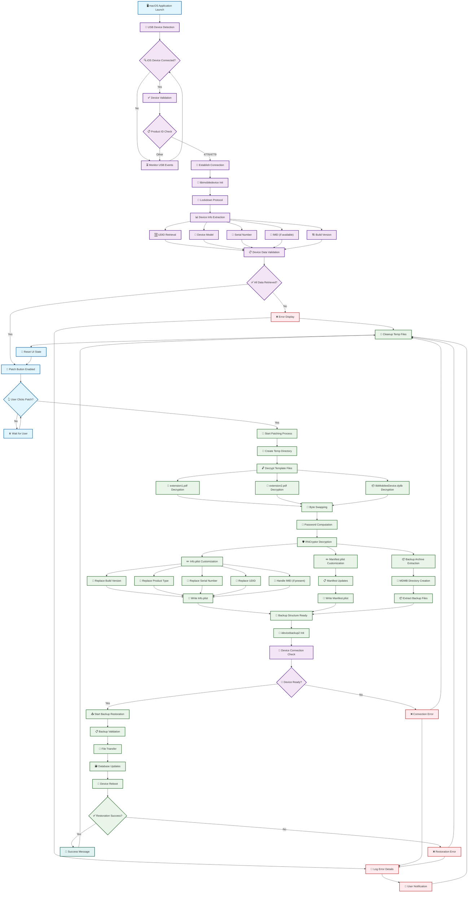

# MDMPatcher Enhanced

### ⚠️ **Legal & Technical Disclaimer**  
> This project is intended strictly for **educational, diagnostic, and personal device recovery use only**.  
> It must **only** be used on iOS devices that the user **legally owns** and has the right to modify.  
>
> **MDMPatcher Enhanced does not jailbreak, exploit or modify firmware**. It relies entirely on public interfaces (AFC, plist editing, USB restore flows).  
>
> The tool targets situations like second-hand iOS devices where MDM was not removed correctly.  
> **Using this software on managed, corporate, or institutional devices without permission is prohibited and may be illegal.**

## Table of Contents

- [Overview](#overview)
- [Requirements](#requirements)
- [Instructions](#instructions)
- [Troubleshooting](#typical-issues)
- [Internals](#internals--architecture)
- [Dependencies](#software-dependencies)

## Overview

MDMPatcher Enhanced is a macOS tool that helps remove or bypass Mobile Device Management (MDM) profiles from supervised iPhones and iPads. It is designed for scenarios where users need to regain full control over a personally owned device — for example after second-hand purchases or faulty deregistration.

No jailbreak is required. No low-level kernel or firmware modifications are performed.

## Permanent MDM removal: what this app can and cannot verify

A successful return code from a local operation is not proof of permanent unenrollment. This application does not have authority to change an organisation's Apple Business Manager/Apple School Manager inventory or its MDM server assignment. If a device remains assigned to Automated Device Enrollment, it can be offered management again during setup.

For a permanent, authorised release, an organisation administrator should release the device from the organisation's device inventory when appropriate, verify the released status, and then erase/restore the device. See Apple's current guidance for [device management](https://support.apple.com/guide/deployment/intro-to-device-management-depc0aadd3fe/web) and the [Apple Business release-device procedure](https://support.apple.com/guide/business/release-devices-axmec4d28461/web).

### Application Preview

## Changes from the Original Repository
- **Improved documentation**
- **Bug fixes**
- **Troubleshooting section added**
- **Clarity improvements for restore & patching**

## Requirements
- macOS 10.13+ (Intel or Apple Silicon)
- iOS 15 to 18.5+
- iPhone 5s to iPhone 16
- All current iPads
- IPSW file for your device (from [ipsw.me](https://ipsw.me))

## Instructions for legitimate device recovery
This repository's local patch result must not be treated as proof that a device has been permanently removed from an organisation's management system. For devices you own or are explicitly authorised to service:

1. Contact the seller or the organisation's IT/MDM administrator and ask them to remove the device from their MDM service.
2. If the device is assigned through Apple Business Manager or Apple School Manager, an administrator with the required permissions must release it from the organisation when appropriate. Merely erasing or restoring the iPhone does not itself change the organisation's server-side assignment.
3. Have the administrator confirm that the device is shown as released/unassigned in the organisation's inventory.
4. After that release is confirmed, erase or restore the device using Apple's supported process and complete Setup Assistant while connected to the internet.
5. If the Remote Management screen appears again, stop and contact the seller, organisation administrator, or Apple Support with proof of purchase. Do not rely on a local success message as confirmation of permanent removal.

If the device uses a removable, user-enrolled management profile, check **Settings > General > VPN & Device Management**. A removal option may be available depending on the profile and organisation policy.

## Typical Issues
### Problem: Unable to Open MDMPatcher Enhanced
You might encounter a security warning preventing the app from opening, as shown below.
 

 
**Solution:**
1. Right-click the app and select Open.
2. If the app still won’t open, go to **System Settings > Privacy & Security** and under the Security section, allow the app by clicking Open Anyway.
 

---

### Problem: App Is Blocked or Crashes on Launch
Do not disable System Integrity Protection (SIP) merely to run this application. Verify the source code, dependencies, and build settings first. Only run software you trust, and use Apple's supported security settings and troubleshooting guidance: [System Integrity Protection](https://developer.apple.com/documentation/security/disabling-and-enabling-system-integrity-protection).

---

### Problem: Error Occurs While Patching
If an error occurs during the patching process, it’s often because the device hasn’t fully completed activation.

**Solution:**
1. Before opening MDMPatcher, open Finder on your Mac.
2. Click on your device in the Finder sidebar.
3. Wait for the device to fully activate (it will display "Get Started" when ready).
4. Then, proceed with the patching.

This should resolve most patching errors.

## Final Thoughts
This project aims to support lawful restoration of iOS/iPadOS devices that were improperly decommissioned. It provides a lightweight, GUI-driven alternative for tech-savvy users who understand the risks and legal limitations involved.

## Internals & Architecture

### System Diagram

### Core Components

| Component | Type | File | Description | Dependencies |
|-----------|------|------|-------------|-------------|
| **Main Application** | Swift | ViewController.swift | Primary UI controller handling device interaction and patching workflow | IOKit, libimobiledevice |
| **USB Detection System** | Swift | USBDetection.swift | Real-time USB device monitoring and iOS device identification | IOKit Framework |
| **Device Information** | Swift | iDeviceInfoFunctions.swift | Device property extraction and parsing structures | PropertyListDecoder |
| **C Bridge Functions** | C Header | libidevicefunctions.h | Function declarations for Swift-C interoperability | libimobiledevice |
| **Device Communication** | C | libidevicefunctions.c | Low-level device communication and callback handling | libimobiledevice, libirecovery |
| **Backup Restoration** | C Header | idevicebackup2.h | Backup restoration function declarations | - |
| **Backup Engine** | C | idevicebackup2.c | Complete backup/restore implementation with command-line interface | libimobiledevice suite |
| **UI Extensions** | Swift | ExtensionsShit.swift | NSAlert extensions for user notifications | AppKit |
| **App Delegate** | Swift | AppDelegate.swift | Application lifecycle management | Cocoa |
| **Bridging Header** | Objective-C | MDMPatcher-Bridging-Header.h | Swift-C interoperability bridge | IOKit, Custom C headers |
